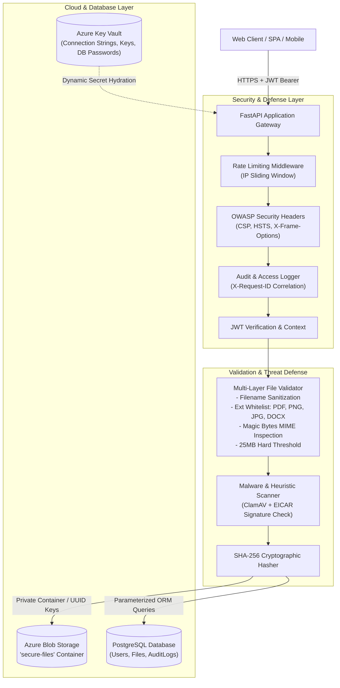

# SecureShare: Production-Grade Cloud-Native Secure File Sharing Platform

[](https://fastapi.tiangolo.com)
[](https://www.python.org/)
[](https://azure.microsoft.com/en-us/services/storage/blobs/)
[](https://azure.microsoft.com/en-us/services/key-vault/)
[](https://www.postgresql.org/)
[](https://github.com)

**SecureShare** is a cloud-based document sharing platform built for enterprise and academic environments requiring fine-grained access control, zero-trust cloud secret management, cryptographic file integrity, and proactive malware defense.

---

## 1. System Architecture



---

## 2. Security Capabilities & Best Practices

| Security Feature | Implementation Strategy | Threat Mitigated |
| :--- | :--- | :--- |
| **Zero-Hardcoded Secrets** | Azure Key Vault (`azure-identity`, `azure-keyvault-secrets`) with `.env` fallback | Credential leak in version control |
| **Private Cloud Storage** | Azure Blob Storage private container (`secure-files`) with short-lived (15 min) SAS URLs | Anonymous unauthorized file enumeration |
| **UUID Filename Masking** | Unpredictable UUID v4 generation (`7c12d5ab-xxxx.pdf`), storing original name in metadata | Path traversal & predictable object enumeration |
| **MIME Spoofing Defense** | Deep Magic Byte analysis (`%PDF-`, `\x89PNG`, `\xFF\xD8\xFF`, OpenXML zip header) | Executable payload disguised as image/PDF |
| **Size Enforcement** | Hard 25MB threshold enforced during streaming read | Resource exhaustion / Denial of Service |
| **Password Security** | Bcrypt work factor (12 rounds) with strict complexity validation | Credential stuffing & rainbow table attacks |
| **JWT Session Isolation** | Dual token scheme (Short-lived Access + Refresh) with `jti` replay tracking | Session hijacking |
| **Object-Level Control (IDOR)** | Strict user ownership verification before metadata retrieval, download, or deletion | Insecure Direct Object References (BOLA/IDOR) |
| **Tamper Resistance** | SHA-256 fingerprinting stored in DB and verified during audit | Data alteration / silent corruption |
| **Malware Prevention** | Real-time ClamAV daemon socket scan & EICAR test signature rejection | Malware and ransomware distribution |
| **SQL Injection Defense** | Strictly parameterized queries via SQLAlchemy 2.0 ORM expressions | SQL injection (SQLi) |
| **Tamper-Evident Auditing** | Dedicated `AuditLogs` table recording registration, auth success/failure, uploads, and deletions | Forensic investigation & accountability |

---

## 3. Project Directory Structure

```
SecureShare/
├── app/
│   ├── api/
│   │   ├── auth.py              # User registration, login, token refresh
│   │   ├── upload.py            # POST /upload endpoint with full security pipeline
│   │   ├── files.py             # File metadata, SAS URL generation, deletion, stream
│   │   ├── shares.py            # Secure sharing links, quota enforcement, recipient access
│   │   └── users.py             # User profile and audit log querying
│   ├── core/
│   │   ├── config.py            # Pydantic Settings loaded from .env & Azure Key Vault
│   │   ├── security.py          # Bcrypt password hashing & JWT token generation
│   │   ├── keyvault.py          # Azure Key Vault client with automatic fallback
│   │   └── exceptions.py        # Custom exception handlers (400, 401, 403, 404, 409, 413, 422, 500)
│   ├── db/
│   │   ├── database.py          # SQLAlchemy engine, connection pooling, get_db dependency
│   │   ├── models.py            # Declarative models (Users, Files, AuditLogs)
│   │   └── crud.py              # Parameterized database operations
│   ├── services/
│   │   ├── blob_service.py      # Azure Blob Storage SDK client, SAS tokens, metadata
│   │   ├── encryption.py        # SHA-256 calculation & AES-256-GCM utilities
│   │   ├── validation.py        # Filename sanitization, MIME & Magic Byte verification
│   │   └── virus_scan.py        # Antivirus scanning (ClamAV & heuristic signatures)
│   ├── middleware/
│   │   ├── auth.py              # JWT authentication middleware & dependency
│   │   ├── logging.py           # Request access logging & OWASP secure headers
│   │   └── rate_limit.py        # IP-based sliding window rate limiter
│   ├── schemas/
│   │   └── __init__.py          # Pydantic v2 request & response schemas
│   ├── utils/
│   │   ├── logger.py            # Enterprise structured logging setup
│   │   └── helpers.py           # Helper utilities
│   └── main.py                  # FastAPI application entrypoint & lifespan
│
├── frontend/                    # Single-Page Application (React 19 + Vite + TypeScript)
│   ├── src/                     # React components, MSAL identity provider, and API client
│   ├── package.json             # Frontend dependencies & npm scripts
│   ├── vite.config.ts           # Vite development server configuration
│   └── README.md                # Dedicated frontend & Entra ID documentation
│
├── alembic/                     # Database migrations
│   ├── versions/
│   │   └── 0001_initial_schema.py
│   └── env.py
├── tests/                       # Automated test suite
│   ├── conftest.py              # Test client, database fixtures, and auth helpers
│   ├── test_api.py              # Comprehensive integration tests
│   └── test_security.py         # Security tests (crypto, IDOR, MIME spoofing)
│
├── .github/workflows/
│   └── devsecops.yml            # CI/CD Pipeline (SAST, SCA, Pytest)
├── Dockerfile                   # Hardened multi-stage non-root container
├── docker-compose.yml           # Complete stack (FastAPI, Postgres, Azurite, ClamAV)
├── bandit.yaml                  # Bandit SAST security configuration
├── .semgrep.yml                 # Semgrep security rules
├── .safety-policy.yml           # Dependency vulnerability scanning policy
├── alembic.ini                  # Alembic configuration
├── .env.example                 # Environment configuration template
├── .env                         # Active configuration
├── requirements.txt             # Locked project dependencies
└── README.md                    # Documentation
```

---

## 4. How to Run the Project

> [!TIP]
> ### ⚡ Quick Reference: 2-Terminal Execution
> SecureShare consists of a Python FastAPI backend and a React (Vite) frontend. For local development, run them in **two separate terminal windows**:
> | Terminal | Working Directory | Primary Command | Port & URL |
> | :--- | :--- | :--- | :--- |
> | **Terminal 1 (Backend)** | `SecureShare/` (root) | `uvicorn app.main:app --host 0.0.0.0 --port 8000 --reload` | `http://localhost:8000` |
> | **Terminal 2 (Frontend)** | `SecureShare/frontend` | `npm run dev` | `http://localhost:5173` |

---

### 4.1 Prerequisites
Before starting, ensure you have the following installed on your machine:
* **Python**: `3.11` or `3.12+` (`python3 --version` or `python --version`)
* **Node.js & npm**: `Node.js 18+` and `npm 9+` (`node -v` and `npm -v`)
* **Git**: Installed and configured (`git --version`)
* **Docker & Docker Compose**: *(Optional)* Required only if running via containers (Method 2)

---

### 4.2 Method 1: Local Development (Recommended)

#### Step 1: Clone and Enter the Repository Root
```bash
# Clone the repository
git clone https://github.com/smarankvs/SecureShare.git

# Navigate into the project root directory
cd SecureShare
```

---

#### Step 2: Configure Environment Variables
Copy the root `.env.example` template into an active `.env` configuration:

```bash
# ------------------------------------------------------------------------------
# Linux / macOS / Git Bash:
# ------------------------------------------------------------------------------
cp .env.example .env

# ------------------------------------------------------------------------------
# Windows PowerShell:
# ------------------------------------------------------------------------------
Copy-Item .env.example .env

# ------------------------------------------------------------------------------
# Windows Command Prompt (CMD):
# ------------------------------------------------------------------------------
copy .env.example .env
```

> [!IMPORTANT]
> **Cryptographic Key Generation:**
> Ensure `SECRET_KEY` in `.env` is set to a secure 64-character hex key. You can generate one instantly with:
> ```bash
> python3 -c "import secrets; print(secrets.token_hex(32))"
> ```

---

#### Step 3: Setup and Start the Backend (Terminal 1)

> [!NOTE]
> Make sure your current working directory is the **project root** (`SecureShare/`), **NOT** the `frontend/` directory.

1. **Create and Activate a Python Virtual Environment:**

   ```bash
   # ===========================================================================
   # Option A: Linux / macOS (bash / zsh)
   # ===========================================================================
   # Create virtual environment in '.venv' folder:
   python3 -m venv .venv

   # Activate virtual environment:
   source .venv/bin/activate
   # (Your terminal prompt will now show '(.venv)')

   # ===========================================================================
   # Option B: Windows (PowerShell)
   # ===========================================================================
   # Create virtual environment:
   python -m venv .venv

   # If script execution is restricted on your system, allow signed scripts once:
   Set-ExecutionPolicy -Scope CurrentUser RemoteSigned

   # Activate virtual environment:
   .\.venv\Scripts\Activate.ps1

   # ===========================================================================
   # Option C: Windows (Command Prompt / CMD)
   # ===========================================================================
   # Create virtual environment:
   python -m venv .venv

   # Activate virtual environment:
   .venv\Scripts\activate.bat
   ```

2. **Install Backend Python Dependencies:**

   ```bash
   # Upgrade pip to the latest release
   pip install --upgrade pip

   # Install all pinned dependencies from requirements.txt
   pip install -r requirements.txt
   ```

   > [!NOTE]
   > On Windows, the `semgrep` dependency is automatically skipped because Semgrep does not currently support native Windows installs. The rest of the backend dependencies still install normally. For SAST scanning on Windows, use WSL or a Linux-based runner instead.

   > [!TIP]
   > **Troubleshooting `command not found: uvicorn`**:
   > If you see `zsh: command not found: uvicorn` or `command not found: alembic`, it means your virtual environment is either not activated or `pip install -r requirements.txt` was not run yet. Verify your prompt displays `(.venv)` and run the install command above.

3. **Initialize the Database:**

   * **Option A — Default SQLite (Zero Setup Required):**
     If PostgreSQL is not running locally, SecureShare automatically detects this and provisions a local SQLite database (`secureshare.db`) with zero manual setup. You can proceed directly to step 4!

   * **Option B — PostgreSQL:**
     If you are running PostgreSQL, ensure your connection string is set in `DATABASE_URL` within `.env`, then apply database migrations:
     ```bash
     # Apply database migrations to PostgreSQL
     alembic upgrade head
     ```

4. **Launch the FastAPI Backend Server:**

   ```bash
   # Run with live-reload enabled (recommended for development):
   uvicorn app.main:app --host 0.0.0.0 --port 8000 --reload

   # Or run using the root runner script:
   python main.py
   ```

   * The Backend REST API is live at **`http://localhost:8000`**
   * The interactive OpenAPI / Swagger docs are live at **`http://localhost:8000/docs`**
   * Keep this **Terminal 1** running!

---

#### Step 4: Setup and Start the Frontend (Terminal 2)

> [!IMPORTANT]
> Open a **NEW / SEPARATE terminal window** for this step. Do not stop or exit the backend server in Terminal 1.

```bash
# 1. Navigate from the project root into the frontend directory:
cd frontend

# 2. Copy the frontend environment template to .env:
# On Linux / macOS / Git Bash:
cp .env.example .env

# On Windows PowerShell:
Copy-Item .env.example .env

# On Windows Command Prompt (CMD):
copy .env.example .env

# 3. Install all Node.js and React dependencies:
npm install

# 4. Start the Vite React development server:
npm run dev
```

* The React Web Dashboard is live at **`http://localhost:5173`**
* The frontend automatically proxies API requests to the backend at `http://localhost:8000`.
* For Microsoft Entra ID (Azure AD) Single Sign-On and Client ID setup, refer to [frontend/README.md](file:///Users/smarankv/Documents/GitHub/SecureShare/frontend/README.md).

---

### 4.3 Method 2: Full-Stack Containerized (Docker Compose)

Run the entire stack — backend, PostgreSQL 16, Azurite (Azure Blob Storage emulator), and ClamAV antivirus daemon — inside isolated containers with Docker:

```bash
# Step 1: Build and launch all 4 services in the background:
docker compose up --build -d

# Step 2: Stream live logs from the backend API container:
docker compose logs -f api

# Step 3: Check health status of all running containers:
docker compose ps

# Step 4: Stop all containers and clean up networks when done:
docker compose down
```

---

### 4.4 Service Endpoints & Verification

Once services are running, verify system health and explore endpoints:

| Service | URL | Purpose / Description |
| :--- | :--- | :--- |
| **Frontend Web App** | `http://localhost:5173` | React 19 + Vite client dashboard & file explorer |
| **Backend REST API** | `http://localhost:8000` | FastAPI root status endpoint |
| **Swagger UI Docs** | `http://localhost:8000/docs` | Interactive OpenAPI documentation & live test console |
| **ReDoc UI Docs** | `http://localhost:8000/redoc` | Clean technical API reference specifications |
| **System Health Check** | `http://localhost:8000/health` | Comprehensive database, storage, and engine health probe |

---

### 4.5 Running Automated Tests

To execute the automated test suite, ensure your virtual environment is active in the project root:

```bash
# 1. Activate virtual environment (from project root):
# Linux / macOS:
source .venv/bin/activate
# Windows PowerShell:
.\.venv\Scripts\Activate.ps1

# 2. Run all unit and integration tests:
pytest -v

# 3. Run specific security validation tests (crypto, IDOR, MIME spoofing):
pytest -v tests/test_security.py
```

---

## 5. Azure Cloud Configuration

### Azure Key Vault Setup
To enable zero-trust cloud secret retrieval:
1. Create Azure Key Vault in Azure Portal: `az keyvault create --name secureshare-kv --resource-group secureshare-rg`
2. Add secrets:
   ```bash
   az keyvault secret set --vault-name secureshare-kv --name "storage-connection-string" --value "<AZURE_STORAGE_CONNECTION_STRING>"
   az keyvault secret set --vault-name secureshare-kv --name "jwt-secret" --value "<64_CHAR_RANDOM_SECRET>"
   az keyvault secret set --vault-name secureshare-kv --name "database-password" --value "<SECURE_DB_PASSWORD>"
   ```
3. In `.env`, set:
   ```env
   AZURE_KEYVAULT_ENABLED=true
   AZURE_KEYVAULT_URL=https://secureshare-kv.vault.azure.net/
   ```

### Azure Blob Storage Setup
1. Create Storage Account: `az storage account create --name securesharestorage --resource-group secureshare-rg`
2. Create Private Container:
   ```bash
   az storage container create --account-name securesharestorage --name secure-files --public-access off
   ```

---

## 6. DevSecOps & Security Verification

Run automated security scanners locally:

- **Bandit (SAST Python AST Scan):**
  ```bash
  bandit -c bandit.yaml -r app/ -ll -v
  ```

- **Semgrep (Rule-based Code Security Analysis):**
  ```bash
  semgrep scan --config=.semgrep.yml app/
  ```

- **Safety (Dependency Vulnerability Scan):**
  ```bash
  safety check -r requirements.txt
  ```

- **Automated Test Suite:**
  ```bash
  pytest -v
  ```
