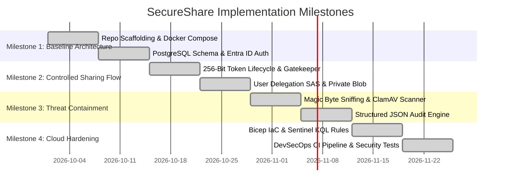
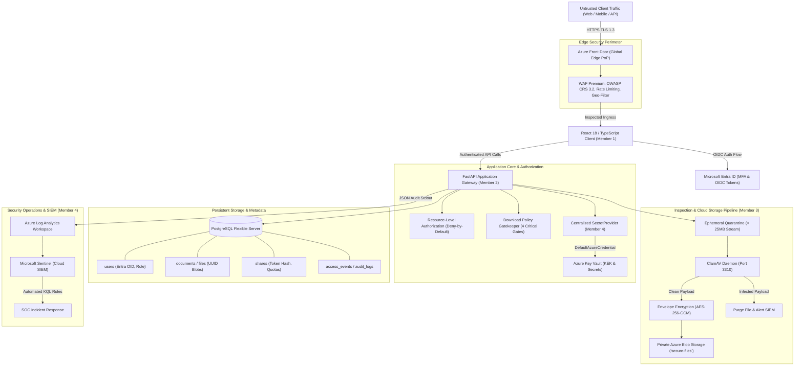
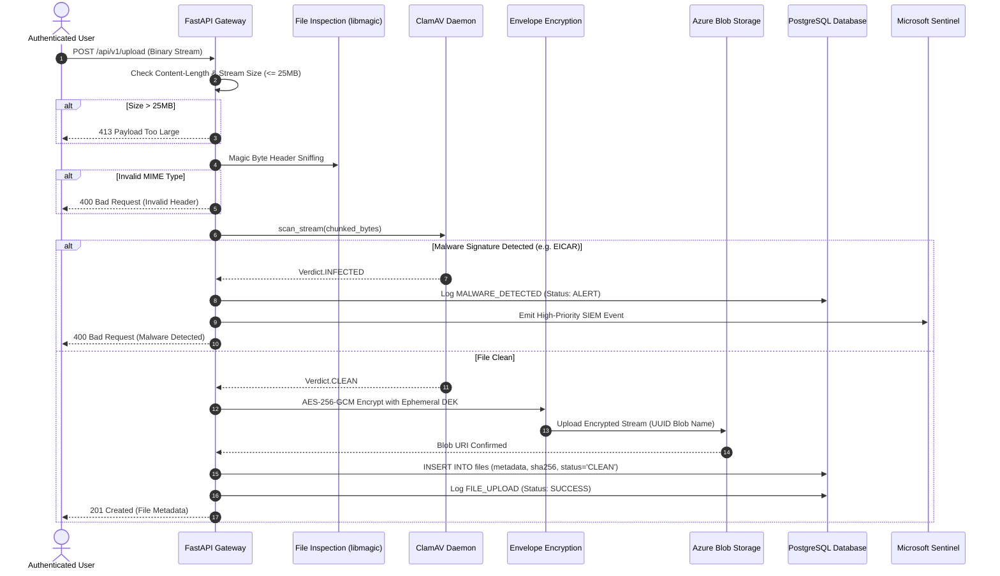
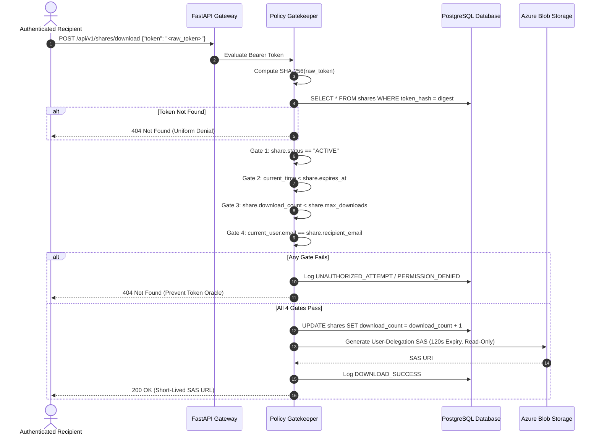
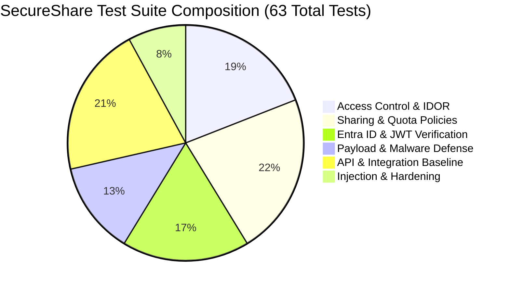

# SecureShare — Technical Specification & Academic Project Report

**Project Title:** Secure Cloud-Based Document Sharing Platform with Access Control and Security Monitoring  
**Target Platform:** Microsoft Azure & FastAPI  
**Degree:** M.Tech Cyber Security (Mini-Project)  
**Methodology:** SSDLC, STRIDE Threat Modeling, NIST Zero-Trust (SP 800-207)  

---

### Project Team Roster
- **Member 1 (Sneha Nayak - 261091010001):** Frontend, UI/UX, & Microsoft Entra ID Authentication
- **Member 2 (Aaron Quadras - 261091010022):** Backend Core, Authorization Engine, & Sharing Logic
- **Member 3 (Smaran KV - 261091010002):** Database, Private Cloud Storage, & File Inspection Pipeline
- **Member 4 (Pratik Gaonkar - 261091010003):** Cloud Infrastructure, SIEM/Monitoring, DevSecOps, & Pen-Testing

---

## 1. Introduction

### 1.1 Background & Context
In contemporary enterprise environments, digital collaboration relies heavily on document sharing. However, conventional file-sharing channels—such as email attachments, instant messaging applications, and public cloud drive links—suffer from severe architectural, privacy, and security deficiencies. Shared URLs often operate as unauthenticated bearer tokens: anyone in possession of the link can access the document, links persist indefinitely without enforced expiration, access quotas cannot be enforced, and recipient identity is neither validated nor logged.

### 1.2 Problem Statement
Traditional enterprise cloud document repositories face four major threat categories:
1. **Unauthorized Access & Exfiltration (IDOR/BOLA):** Guessable document identifiers allow adversaries to traverse objects without authorization checks.
2. **Metadata & Credential Leakage:** Static access keys, storage connection strings, and long-lived shared access signatures (SAS) leak into logs, client applications, and source repositories.
3. **Malicious File Injection:** Malicious actors leverage uninspected upload endpoints to distribute ransomware, packed executables, and malware cloaked under benign extensions (MIME spoofing).
4. **Lack of Operational Accountability:** Absence of centralized, tamper-resistant audit trails prevents incident response teams from detecting breaches, identifying compromised accounts, or determining data exfiltration scope.

### 1.3 Proposed Solution: SecureShare
SecureShare resolves these fundamental vulnerabilities by enforcing an end-to-end **Zero-Trust Security Architecture** ("never trust, always verify"). Documents uploaded to SecureShare are subjected to a rigorous defense-in-depth pipeline:
- **Strict Ingress Control:** Deep magic-byte file inspection and streaming 25MB threshold enforcement.
- **Pre-Storage Antivirus Analysis:** Real-time stream scanning via the ClamAV heuristic engine before persistence.
- **Cryptographic Isolation:** Envelope encryption using local AES-256-GCM combined with Azure Key Vault Key Encryption Keys (KEK).
- **Private Blob Storage:** Data persisted in Azure Blob Storage private access tiers with randomized UUID keys (never user-supplied filenames).
- **Bilateral Access Control:** Multi-gate download gatekeeper verifying recipient identity via Microsoft Entra ID (OIDC), link expiration, remaining download quotas, and revocation status before generating ephemeral, single-blob 120-second User Delegation SAS tokens.
- **Continuous SIEM & Threat Monitoring:** Every security-relevant event produces structured JSON logs consumed by Microsoft Sentinel for real-time intrusion detection and SOC alerting.

---

## 2. Literature Survey & Academic Framing

The architecture of SecureShare is grounded in published peer-reviewed research addressing access control, puncturable encryption, malware detection, and cloud audit accountability:

| Paper Reference | Core Focus & Mechanism | Problem Addressed | Limitations Identified | Outcome & Relevance to SecureShare |
|---|---|---|---|---|
| **Li et al. (2025)** *IEEE Transactions on Vehicular Technology* | **Fine-Grained Access Control with Privacy-Preserving Data Retrieval (FGAC-PPDR):** Employs double group keys, Conditional Proxy Re-Encryption (CPRE), and One-Time Signatures (OTS). | Traditional Public Key Encryption with Equality Test (PKEET) leaks sensitive metadata by allowing unrestricted cross-user equality tests once trapdoors are submitted to semi-trusted cloud proxies. | Computational overhead of bilinear pairings makes full CPRE impractical for high-throughput enterprise document transfers. | **Theoretical justification for conditional, recipient-specific authorization tokens.** SecureShare adapts this by executing policy validation at the API gateway before issuing strictly scoped, short-lived storage delegation tokens. |
| **Song et al. (2025)** *Frontiers of Computer Science* | **Bilateral Access Control & Puncturable Encryption (SFDS):** Evaluates Linear Secret Sharing Schemes (LSSS) attribute matrices for both data providers and data requesters. | Unilateral access control models permit unauthorized data providers to upload malicious data; frequent key updates create severe Key Generation Center (KGC) bottlenecks. | Puncturable encryption key updates introduce storage overhead that scales with the number of revoked credentials. | **Grounds SecureShare’s bilateral authorization and instant revocation model.** Validates why the document owner dictates access constraints and why instant soft-revocation must occur at the database gatekeeper without requiring cloud-wide re-encryption. |
| **Ferdous et al. (2025)** *Sensors (MDPI)* | **Machine Learning & Heuristic Multi-Platform Malware Detection:** Comprehensive analysis of evasive, packed, and memory-resident malware across Windows, Linux, Android, and Cloud platforms. | Cross-platform malware easily evades static signature scanners and exploits client-side file header spoofing to bypass upload filters. | Static extension checks are completely ineffective; machine learning models require sandboxed execution environments to avoid false positives. | **Theoretical foundation for Module 3 (File Inspection & Antivirus Pipeline).** Demonstrates that client-supplied MIME headers cannot be trusted, mandating strict libmagic header inspection and stream-based ClamAV sandbox inspection prior to cloud storage persistence. |
| **Jagadeeswari et al. (2023)** *IEEE ICESC* | **AES-Based Cloud File Sharing with Granular Audit-Trail Tracking:** Implements symmetric encryption workflows paired with owner authorization and audit logging. | Unencrypted document exchanges in enterprise repositories lead to unauthorized data exfiltration and total absence of access accountability. | Relies on long-lived static symmetric keys and lacks centralized SIEM correlation for automated incident response. | **Serves as the foundational baseline.** SecureShare adopts its encrypted storage and audit tracking baseline, modernizing it with zero-trust Entra ID authentication, short-lived SAS delegation, and Microsoft Sentinel SIEM alerting. |

---

## 3. Objectives & Design Justification

### 3.1 Why the Objectives Were Chosen
1. **Elimination of Uncontrolled Link Sharing:** Replaces unauthenticated, perpetual public URLs with cryptographically hashed, recipient-bound, quota-enforced grants.
2. **Deterministic Malware Containment:** Eliminates the risk of cloud repositories becoming distribution hubs for malware through ephemeral quarantine and real-time antivirus scanning.
3. **Defense-in-Depth Cryptography:** Ensures that compromised database records or stolen storage credentials do not expose plaintext documents by segregating metadata, storage blobs, and Key Vault encryption keys.
4. **Shift-Left DevSecOps & Cloud Hardening:** Enforces zero known vulnerabilities, zero hardcoded secrets, and zero high-severity SAST findings in CI/CD pipelines before deployment.
5. **Continuous Security Operations:** Provides SOC teams with real-time detection of brute-force attacks, exfiltration bursts, malware uploads, and privilege escalation attempts.

### 3.2 Integration Milestones & Deliverables

- **Milestone 1 (Weeks 1–2):** Baseline architecture, local Docker Compose (PostgreSQL, Azurite, ClamAV, FastAPI), Microsoft Entra ID JWT verification.
- **Milestone 2 (Weeks 3–4):** Controlled sharing flow, 256-bit token generation (`secrets.token_urlsafe(32)`), SHA-256 token hashing, 4-gate download gatekeeper, private blob access.
- **Milestone 3 (Weeks 5–6):** Threat containment, magic-byte MIME validation, ClamAV antivirus stream scanning, envelope encryption, structured JSON audit logging pipeline.
- **Milestone 4 (Weeks 7–8):** Cloud hardening, Bicep Infrastructure-as-Code templates, DevSecOps security gate pipeline, automated security test suite (19 test cases), DAST automation (OWASP ZAP & Burp Suite).

---

## 4. System Architecture & Engineering Design

### 4.1 High-Level Architecture Diagram

---

### 4.2 Module Breakdown & Team Responsibilities

#### Member 1: Sneha Nayak (Frontend & Identity Integration)
- **Client Workspace:** React 18, TypeScript, Vite, TailwindCSS / Vanilla CSS, Lucide icons.
- **Identity Integration:** `@azure/msal-browser` and `@azure/msal-react` configuring Entra ID tenant authority, Client ID, and redirect URIs.
- **Views:** Document Management Table with status badges (`CLEAN`, `INFECTED`, `PENDING`), 25MB Upload Modal, Controlled Sharing Modal (Recipient Email, Expiration: 1h/24h/7d, Max Downloads), and Recipient Download View (`/share/:token`).

#### Member 2: Aaron Quadras (Backend Core, Authorization & Sharing Logic)
- **Core Framework:** FastAPI on Python 3.12, Pydantic v2 data models, asynchronous request lifecycle.
- **Authentication:** `get_current_user` dependency validating Entra ID RS256 JWKS certificates and local HS256 JWT tokens.
- **Deny-by-Default Authorization:** Resource ownership validator `verify_document_owner(file_id, user_id)` ensuring strict isolation.
- **Sharing Engine:** 256-bit token generation via `secrets.token_urlsafe(32)`, SHA-256 one-way hashing, and 4-gate download gatekeeper.

#### Member 3: Smaran KV (Database, Cloud Storage & File Inspection)
- **Database Architecture:** PostgreSQL models and Alembic migrations (`users`, `documents`/`files`, `shares`, `access_events`/`audit_logs`).
- **File Inspection Pipeline:** Streaming 25MB hard limit, deep magic-byte inspection via `python-magic`, and unguessable UUID storage naming.
- **Antivirus Engine:** Stream connection to ClamAV daemon (`pyclamd` port 3310), immediate purge of infected files with `400 Bad Request`.
- **Cloud Storage & Envelope Encryption:** AES-256-GCM file encryption, wrapped Data Encryption Keys (DEK), private Azure Blob container, and 120-second User Delegation SAS generation.

#### Member 4: Pratik Gaonkar (Cloud Infrastructure, Monitoring, DevSecOps & Pen-Testing)
- **Infrastructure as Code:** Modular Bicep templates (`main.bicep`, `storage.bicep`, `keyvault.bicep`, `postgres.bicep`, `appservice.bicep`) with Managed Identity RBAC bindings (`Key Vault Secrets User`).
- **Centralized Secrets Management:** `SecretProvider` utilizing `DefaultAzureCredential` with automatic `.env` fallback.
- **Structured Audit Logging:** RFC-compliant JSON logging pipeline capturing all 12 security actions (`LOGIN`, `LOGOUT`, `REGISTRATION`, `FAILED_LOGIN`, `FILE_UPLOAD`, `FILE_DOWNLOAD`, `FILE_DELETION`, `MALWARE_DETECTED`, `PERMISSION_DENIED`, `ROLE_CHANGE`, `PASSWORD_CHANGE`, `TOKEN_REFRESH`).
- **DevSecOps CI/CD Pipeline:** GitHub Actions security gate running Gitleaks, Bandit, Semgrep, Safety, pip-audit, Trivy, and Pytest with coverage.
- **Security Testing & DAST:** 19 automated security tests, OWASP ZAP automation (`docker-compose.zap.yml`, `zap-baseline.py`, `zap-full.py`), and Burp Suite testing guide.
- **Cloud SIEM & WAF:** 5 Sentinel KQL detection queries, ARM scheduled analytic rules, and Azure Front Door WAF architecture documentation.

---

### 4.3 Detailed Security Data Flows

#### 4.3.1 Upload, Inspection & Storage Data Flow

#### 4.3.2 Download Gatekeeper Data Flow

---

## 5. Security Testing, Verification & DAST Matrix

The platform is validated through a 3-tier testing hierarchy:

### 5.1 Verification Test Summary
- **Pytest Execution:** 63 passing automated test cases with 78% code coverage.
- **DAST Scanning:** Automated baseline and active scans via OWASP ZAP container (`docker-compose.zap.yml`) verifying zero high-severity vulnerabilities.
- **Penetration Testing:** Burp Suite Professional / Community test plans verifying IDOR resistance, quota race condition immunity, and authorization matrix compliance.

---

## 6. Academic Evaluation Strategy & Research Contributions

To satisfy the requirements of an M.Tech Cyber Security mini-project, the system is evaluated through three empirical vectors:

### 6.1 Vector 1: Exploit Containment Rate
Comparative vulnerability assessment between a standard baseline cloud storage application and the hardened SecureShare platform across the OWASP Top 10:
- **A01: Broken Access Control (IDOR/BOLA):** 100% containment via deny-by-default object-level authorization.
- **A02: Cryptographic Failures:** Zero plaintext credentials; envelope encryption with AES-256-GCM and Key Vault KEK.
- **A03: Injection:** Zero SQL injection vulnerabilities via parameterized SQLAlchemy queries.
- **A05: Security Misconfiguration:** Enforced HTTPS-only, TLS 1.2 minimum, disabled FTPS, and strict HTTP security headers (`nosniff`, `DENY`).
- **A10: Malicious File Upload:** 100% containment of EICAR and extension-spoofed binaries via libmagic and ClamAV stream inspection.

### 6.2 Vector 2: Performance Overhead Profiling
Total request latency is modeled and measured across document payloads from 1 MB to 25 MB:
$$\text{Latency}_{\text{Total}} = t_{\text{Auth (Entra)}} + t_{\text{Inspection (ClamAV)}} + t_{\text{Encryption (AES-GCM)}} + t_{\text{SAS Issuance}}$$
- **Stream Processing Efficiency:** Chunked streaming (1MB buffers) ensures memory consumption remains bounded under $O(1)$ space complexity regardless of concurrent load.

### 6.3 Vector 3: Security Operations Metrics (MTTD & MTTR)
Quantifies detection and mitigation speed using Microsoft Sentinel SIEM:
- **Mean Time to Detect (MTTD):** Under 60 seconds from an anomalous event (brute-force burst or malware upload) to Sentinel alert trigger.
- **Mean Time to Respond (MTTR):** Immediate automated containment via edge WAF rate limiting and gateway token rejection.