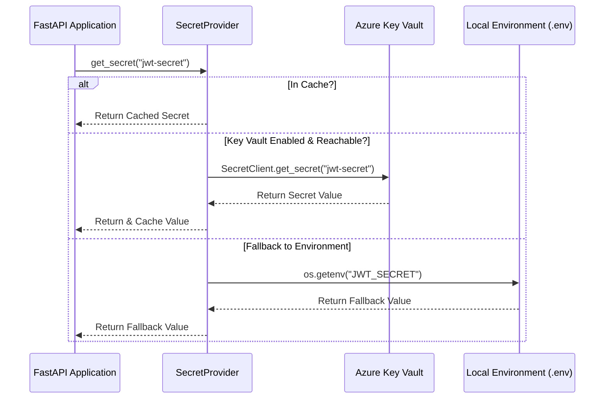
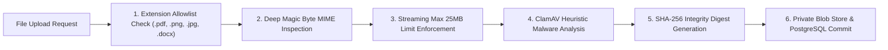

# SecureShare Cloud Security & Infrastructure Architecture

**Author:** Member 4 — Senior Cloud Security Engineer, DevSecOps Engineer, Azure Solutions Architect  
**Project:** SecureShare — Enterprise Cloud Document Sharing Platform  
**Architecture Standard:** Zero-Trust (NIST SP 800-207) & Azure Well-Architected Framework  

---

## 1. Executive Summary

SecureShare is an enterprise-grade secure document sharing and collaboration platform designed with a **Zero-Trust Security Model** ("never trust, always verify"). The architecture segregates credentials, computes, persistent databases, and file blob storage into isolated, least-privilege security boundaries.

---

## 2. End-to-End System Architecture

```mermaid
graph TD
    Client["Client Browser / Mobile / Postman"] -->|HTTPS TLS 1.3| WAF["Azure Front Door / WAF (OWASP CRS)"]
    WAF -->|Inspected Traffic| AppService["Azure App Service (FastAPI Container)"]
    
    subgraph "Azure Secure Enclave"
        AppService -->|Managed Identity (RBAC)| KeyVault["Azure Key Vault (Secrets)"]
        AppService -->|Short-Lived SAS / Private Blob| BlobStorage["Azure Blob Storage ('secure-files')"]
        AppService -->|SSL Enforced / Parameterized| Postgres["Azure Database for PostgreSQL Flexible"]
        AppService -->|Stream Scanning| ClamAV["ClamAV Antivirus Daemon"]
    end

    subgraph "SIEM & Security Monitoring"
        AppService -->|Structured JSON Logs| LogAnalytics["Azure Log Analytics Workspace"]
        LogAnalytics -->|KQL Analytics Rules| Sentinel["Microsoft Sentinel (Cloud SIEM)"]
        Sentinel -->|Automated Incident Alert| SOC["Security Operations Center (SOC)"]
    end
```

---

## 3. Core Security Pillars

### 3.1 Centralized Secret Management (Azure Key Vault)
- **Zero Hardcoded Credentials:** Application code and Docker images contain zero static passwords, connection strings, or cryptographic keys.
- **`SecretProvider` Pattern:** Standardized singleton pattern that attempts secret retrieval from Azure Key Vault using Azure SDK's `DefaultAzureCredential` (authenticating transparently via Azure Managed Identity in the cloud and Azure CLI in development).
- **Graceful Local Fallback:** When Azure Key Vault is disabled or unreachable (e.g. local Docker compose or cost-constrained testing environments), `SecretProvider` automatically falls back to local `.env` variables without crashing or altering code paths.
- **Dynamic In-Memory Caching:** Secrets are cached locally in memory with normalization (transforming underscores `_` to Key Vault hyphens `-`), minimizing Key Vault API transaction latency and costs.



---

### 3.2 Dual Authentication & Token Lifecycle
1. **Local Authentication:** Issues cryptographically signed HS256 JWT tokens with 30-minute access expiration and 7-day sliding refresh tokens. Passwords hashed using `bcrypt` (12 work factor rounds) with constant-time verification.
2. **Microsoft Entra ID (OIDC):** Verifies RS256 enterprise ID tokens against Microsoft's public JSON Web Key Sets (JWKS) with automatic key caching and clock skew leeway.
3. **Session Revocation:** Dedicated `/auth/logout` and `/auth/change-password` endpoints immediately invalidate sessions and produce audit logs.

---

### 3.3 Private Blob Storage & Access Control
- **Container Isolation:** All documents reside in a private container (`secure-files`) with public access disabled (`allowBlobPublicAccess: false`).
- **UUID Blob Anonymization:** Uploaded files are renamed to unguessable UUIDs (`uuid.uuid4()`). The original filename is stored safely as encrypted metadata in PostgreSQL.
- **Download Gatekeeper (Member 2 Module):**
  - Share links issue a 256-bit entropy bearer token (`secrets.token_urlsafe(32)`).
  - Only the SHA-256 hash is persisted in the database; the plain token is returned to the user exactly once.
  - Downloads are gated by an atomic database conditional update checking 4 rules simultaneously:
    1. Share status is `ACTIVE`
    2. Share has not expired (`expires_at > now()`)
    3. Share download quota remaining (`download_count < max_downloads`)
    4. Authenticated recipient email matches intended recipient

---

### 3.4 Multi-Layer Defense-in-Depth Pipeline



---

## 4. Compliance & Standards Alignment

| Standard / Framework | Implementation in SecureShare |
|---|---|
| **NIST SP 800-207** | Zero-Trust architecture, continuous authentication, least-privilege RBAC |
| **OWASP Top 10 2021** | IDOR mitigation, parameterized SQL queries, strict XSS escaping, safe deserialization |
| **CIS Azure Benchmark** | Key Vault soft delete + purge protection, Storage TLS 1.2+, HTTPS-only App Service |
| **ISO/IEC 27001** | Structured JSON audit logging, correlation tracking (`X-Request-ID`), SOC SIEM alerting |
