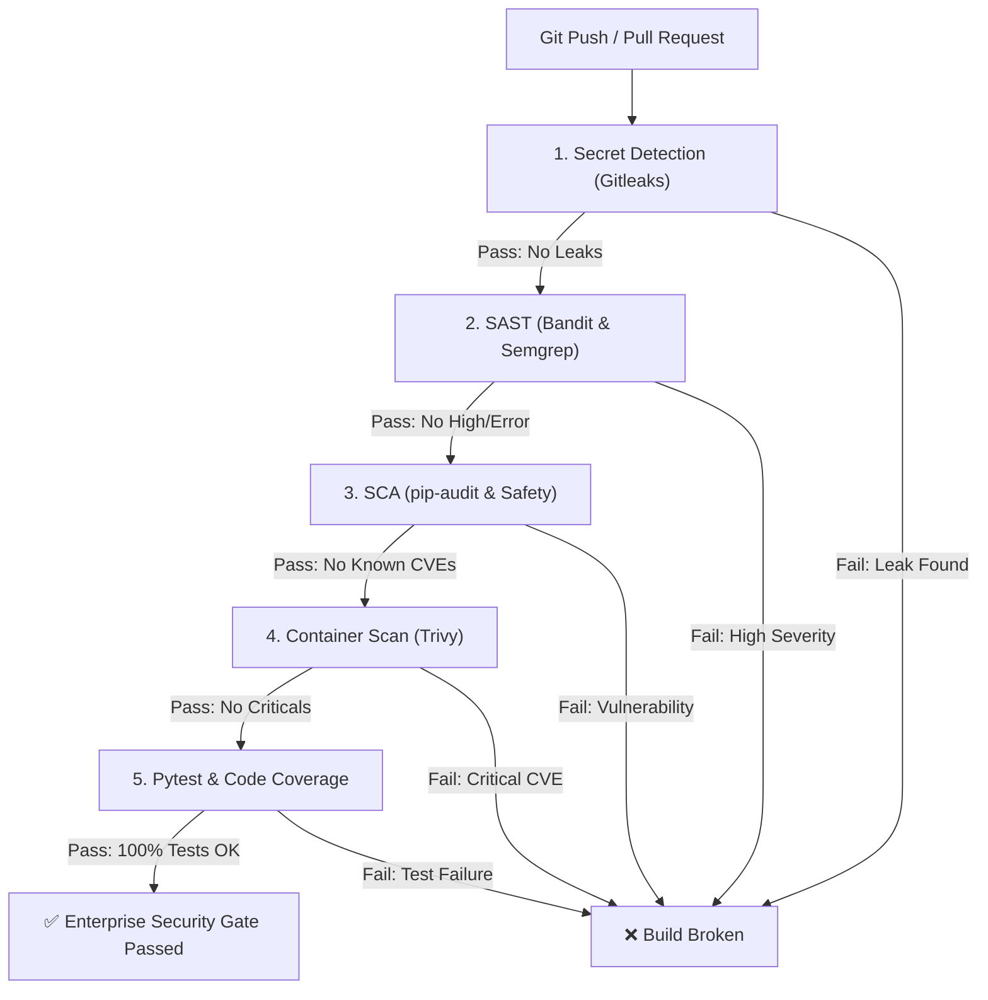

# SecureShare DevSecOps Pipeline & Security Quality Gate

**Author:** Member 4 — Senior DevSecOps Engineer  
**Standard:** NIST SP 800-218 (Secure Software Development Framework)  

---

## 1. Overview & Shift-Left Philosophy

SecureShare implements a **Shift-Left DevSecOps** pipeline where security validation is integrated into every phase of the CI/CD lifecycle rather than treated as a post-deployment afterthought.

Every push or pull request to `main`, `master`, or `develop` triggers automated secret scanning, static application security testing (SAST), software composition analysis (SCA), container vulnerability scanning, and automated security test suites with coverage thresholds.

---

## 2. CI/CD DevSecOps Workflow



---

## 3. Toolchain & Security Gate Specification

| Pipeline Stage | Security Tool | Scan Scope | Failure / Security Gate Threshold |
|---|---|---|---|
| **Secret Scanning** | **Gitleaks v2** | Full git history & working tree | **Any detected credential, API key, or token** (`exit code != 0`) |
| **SAST (AST Analysis)** | **Bandit** | Python AST (`app/` codebase) | **High severity findings** (`--severity-level high`) |
| **SAST (Rule Engine)** | **Semgrep** | Semantic code patterns (`.semgrep.yml`) | **ERROR / High severity rules** (`--severity ERROR`) |
| **SCA (Dependencies)** | **pip-audit** | Installed Python packages | **Any unpatched CVE in requirements.txt** (`--strict`) |
| **SCA (Advisories)** | **Safety** | Known vulnerability database | **Critical / High CVE advisories** |
| **Container Security** | **Trivy** | Docker container OS & libs | **CRITICAL severity vulnerabilities** (`exit-code 1`) |
| **Automated Testing** | **pytest + pytest-cov**| Unit, Integration & Security Suites | **Any failing test or coverage regression** |

---

## 4. Pipeline Jobs Implementation

### 4.1 Secret Scanning (`secret_detection`)
- Uses `gitleaks/gitleaks-action@v2` with `fetch-depth: 0` to scan entire git history.
- Prevents private keys, Azure connection strings, and JWT secrets from ever entering source control.

### 4.2 Static Application Security Testing (`sast_security_scan`)
- **Bandit:** Enforces rules for hardcoded passwords, insecure SQL statements, weak random generators, and deprecated cryptographic algorithms (`bandit -c bandit.yaml -r app/ -ll --severity-level high`).
- **Semgrep:** Enforces rules defined in `.semgrep.yml` for SQL injection patterns, unsafe deserialization, missing security headers, and timing attack vulnerabilities.

### 4.3 Software Composition Analysis (`sca_dependency_scan`)
- **pip-audit:** Cross-references installed package versions against the Python Packaging Advisory Database (PyPA) and OSV.
- **Safety:** Scans `requirements.txt` against Safety DB to identify insecure dependencies.

### 4.4 Container Security (`container_security_scan`)
- Builds the production Docker image and runs Aqua Security's **Trivy**:
  ```yaml
  - name: Run Trivy Image Security Scan
    uses: aquasecurity/trivy-action@master
    with:
      image-ref: secureshare-api:${{ github.sha }}
      format: 'table'
      exit-code: '1'
      ignore-unfixed: true
      vuln-type: 'os,library'
      severity: 'CRITICAL'
  ```

### 4.5 Testing & Code Coverage (`test_and_coverage`)
- Executes all 63 unit, integration, and security tests under an isolated SQLite in-memory environment.
- Enforces code coverage reporting (`coverage.xml`) uploaded as an artifact for traceability.

---

## 5. Security Gate Enforcement

The pipeline concludes with a consolidated `security_gate` job that depends on all 5 prerequisite scanning stages. If any scan fails its threshold, the pipeline halts immediately, prevents deployment to Azure App Service, and flags the pull request as non-compliant.
