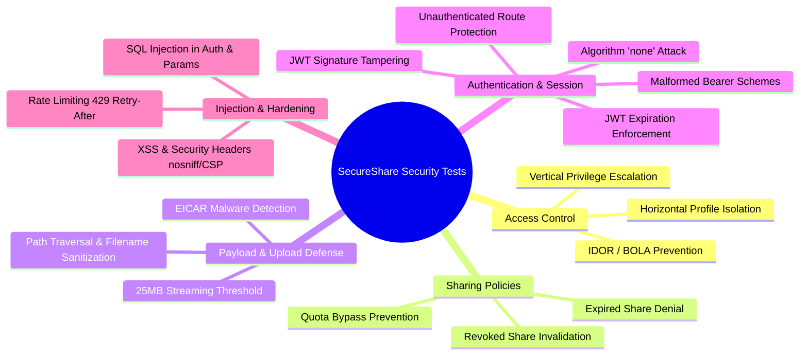

# SecureShare Security Testing & DAST Playbook

**Author:** Member 4 — Senior Security Test Engineer & Ethical Hacker  
**Testing Frameworks:** Pytest, OWASP ZAP, Burp Suite Professional / Community  
**Methodology:** OWASP Web Security Testing Guide (WSTG v4.2)  

---

## 1. Automated Security Test Suite (`tests/security/`)

SecureShare includes 19 dedicated automated security test cases executing within `pytest`:



### 1.1 Test Case Breakdown

| Test File | Vulnerability Tested | Test Methodology & Assertion |
|---|---|---|
| `test_idor.py` | Insecure Direct Object Reference (IDOR) | User B attempts to access metadata, download stream, or delete User A's file. Asserts `403 Forbidden` and `PERMISSION_DENIED` audit log. |
| `test_broken_access_control.py` | Privilege Escalation & Profile Isolation | Standard user attempts `PATCH /users/{id}/role` to grant `admin` role. Asserts `403 Forbidden` and role remains unchanged. |
| `test_quota_bypass.py` | Share Download Quota Bypass | Recipient attempts downloading through single-use share (`max_downloads=1`) a second time. Asserts download 1 succeeds (`200 OK`) and download 2 fails (`404 Not Found`). |
| `test_expired_link.py` | Expired Link Access | Attempts to create or download through an expired share link. Asserts `422 Unprocessable` / gatekeeper denial. |
| `test_revoked_link.py` | Revoked Link Access | File owner revokes share (`POST /shares/{id}/revoke`). Asserts subsequent download attempts immediately return `404 Not Found`. |
| `test_malware_upload.py` | Antivirus / Malware Upload (EICAR) | Uploads standard benign EICAR antivirus test signature. Asserts `400 Bad Request` and `MALWARE_DETECTED` high-severity audit event. |
| `test_large_file_upload.py` | File Upload Denial-of-Service | Streams 26MB of data exceeding `MAX_FILE_SIZE_BYTES` (25MB). Asserts `413 Payload Too Large` without server exhaustion. |
| `test_jwt_tampering.py` | JWT Cryptographic Tampering | Flips bytes in JWT signature, submits expired tokens, and tests `alg: none` unsigned tokens. Asserts `401 Unauthorized`. |
| `test_sql_injection.py` | SQL Injection (SQLi) | Injects SQL payloads (`' OR '1'='1`, `'; DROP TABLE users; --`) in login and query parameters. Asserts safe parameterization and zero database errors. |
| `test_xss.py` | Cross-Site Scripting (XSS) & Headers | Submits script payloads in filenames and verifies sanitization. Verifies `nosniff`, `X-Frame-Options: DENY`, `X-XSS-Protection`, and `Strict-Transport-Security`. |
| `test_auth_bypass.py` | Authentication Bypass | Probes all protected endpoints without Authorization headers or with malformed Bearer schemes. Asserts `401 Unauthorized`. |
| `test_rate_limit.py` | Brute Force & Rate Limiting | Sends rapid bursts of requests from a client IP. Asserts `429 Too Many Requests` with RFC-compliant `Retry-After` header. |

---

## 2. Dynamic Application Security Testing (DAST) with OWASP ZAP

SecureShare provides automated containerized DAST testing via official OWASP ZAP:

### 2.1 Starting DAST Environment
```bash
# Launch API, PostgreSQL, and ZAP scanner in dedicated network
docker compose -f docker-compose.zap.yml up --build -d
```

### 2.2 Running Passive Baseline Scan
```bash
# Runs passive scan and spidering against target API
python3 zap-baseline.py --url http://localhost:8000 --output ./reports/zap
```
- **Security Gate:** Analyzes `reports/zap/zap_baseline_report.json` and automatically exits with code `1` if High-risk vulnerabilities exist.

### 2.3 Running Full Active Attack Scan
```bash
# Imports OpenAPI spec and runs active vulnerability payloads
python3 zap-full.py --url http://localhost:8000 --openapi http://localhost:8000/openapi.json
```

---

## 3. Burp Suite Testing Guide (Professional & Community)

### 3.1 Proxy Configuration & SSL Interception
1. **Burp Proxy Listener:** Ensure listener is active on `127.0.0.1:8080`.
2. **Browser / Client Proxy:** Configure browser or HTTP client to route traffic through `127.0.0.1:8080`.
3. **CA Certificate:** Import Burp CA certificate (`http://burp/cert`) into your operating system or browser trusted root store.
4. **Target Scope:** Add `http://localhost:8000` and `https://*.azurewebsites.net` to `Target -> Scope`. Enable *"Show only in-scope items"* to avoid clutter.

---

### 3.2 Testing IDOR & Authorization with Burp Repeater
1. **Session Setup:**
   - Log in as **User A** in Browser A (or Tab 1); copy JWT token.
   - Log in as **User B** in Browser B (or Tab 2); copy JWT token.
2. **File Access Verification:**
   - Upload a test file using User A: note `file_id` (e.g. `461c41a5-22c6-470c-b37d-ad1e5dba1e98`).
   - In **Burp Repeater**, send:
     ```http
     GET /api/v1/files/461c41a5-22c6-470c-b37d-ad1e5dba1e98 HTTP/1.1
     Host: localhost:8000
     Authorization: Bearer <USER_B_TOKEN>
     ```
   - **Expected Result:** Status `403 Forbidden`, response `{"error": {"code": "FORBIDDEN", ...}}`.

---

### 3.3 Testing Quota Race Conditions with Burp Intruder
1. Generate a share token with `max_downloads=1`.
2. Intercept the download request:
   ```http
   POST /api/v1/shares/download HTTP/1.1
   Host: localhost:8000
   Authorization: Bearer <RECIPIENT_TOKEN>
   Content-Type: application/json

   {"token": "<SHARE_TOKEN>"}
   ```
3. Send to **Intruder**:
   - Attack type: **Null Payloads**
   - Number of requests: `20`
   - Concurrency: `20 threads` (parallel burst)
4. **Expected Result:** Exactly **1 request** returns `200 OK` (quota reserved). The remaining 19 requests return `404 Not Found` (quota exhausted). Demonstrates atomic conditional SQL update safety.

---

### 3.4 Automated Matrix Testing with `Autorize` (BApp Store)
1. Install **Autorize** from the Burp BApp Store.
2. Place **User B's** Authorization header (`Bearer <USER_B_TOKEN>`) in the Autorize configuration.
3. Browse the application as **User A** (creating files, generating shares, viewing audit logs).
4. **Autorize Execution:** Autorize automatically repeats each request replacing User A's token with User B's token.
5. All sensitive document endpoints should display **Enforced** (Green / `403 Forbidden`).
