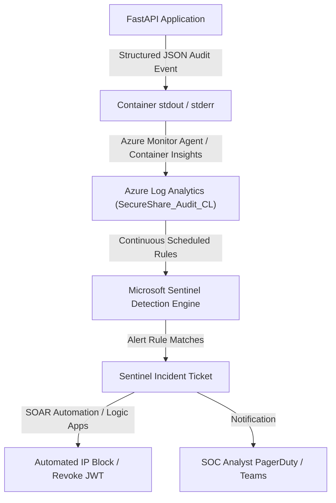

# Microsoft Sentinel SIEM Architecture & Threat Detection

**Author:** Member 4 — Senior Cloud Security Operations Engineer & SIEM Architect  
**Technology:** Microsoft Sentinel (Cloud Native SIEM / SOAR), Azure Log Analytics, Kusto Query Language (KQL)  
**Framework Mapping:** MITRE ATT&CK for Enterprise  

---

## 1. Overview & Detection Pipeline

SecureShare integrates directly with **Microsoft Sentinel** to provide continuous security monitoring, real-time intrusion detection, and automated incident triage across all identity, storage, and API access surfaces.



---

## 2. Ingestion Schema (`SecureShare_Audit_CL`)

Every sensitive security event in SecureShare is emitted as a structured JSON object:

```json
{
  "timestamp": "2026-10-27T15:10:47.400130+00:00",
  "event_type": "SECURITY_AUDIT",
  "action": "LOGIN",
  "user_id": "9415b81b-7c86-466d-87db-f9a94e8b343e",
  "username": "user@example.com",
  "resource": "auth/login",
  "status": "SUCCESS",
  "ip_address": "198.51.100.22",
  "user_agent": "Mozilla/5.0 ...",
  "request_id": "3a21d6d3-8288-4a2f-9bba-d04207f424e1",
  "details": "User authenticated: user@example.com"
}
```

In Log Analytics, this automatically populates the custom log table `SecureShare_Audit_CL` with typed fields: `action_s`, `user_id_s`, `username_s`, `resource_s`, `status_s`, `ip_address_s`, `user_agent_s`, `request_id_s`, and `details_s`.

---

## 3. Sentinel KQL Detection Rules

### 3.1 Brute Force & Credential Stuffing (`failed_login.kql`)
- **Tactic:** Credential Access (`T1110`)
- **Logic:** Identifies when an IP address incurs $\ge 5$ failed authentication attempts within a sliding 5-minute window.
- **Rule File:** `security/sentinel/failed_login.kql`

### 3.2 Abnormal File Upload Spike (`upload_anomaly.kql`)
- **Tactic:** Initial Access / Impact (`T1565`)
- **Logic:** Detects when a single user account uploads $\ge 20$ documents within 10 minutes, indicating automated bot activity or denial-of-service storage flooding.
- **Rule File:** `security/sentinel/upload_anomaly.kql`

### 3.3 Antivirus Malware Detection (`malware_detection.kql`)
- **Tactic:** Execution / Defense Evasion (`T1204`)
- **Logic:** Triggers an immediate Critical severity incident when ClamAV identifies a virus signature during upload.
- **Rule File:** `security/sentinel/malware_detection.kql`

### 3.4 Mass Data Exfiltration Burst (`excessive_downloads.kql`)
- **Tactic:** Exfiltration (`T1020`, `T1048`)
- **Logic:** Flags an alert when an account downloads $\ge 15$ documents within 5 minutes, signaling potential account takeover or intellectual property exfiltration.
- **Rule File:** `security/sentinel/excessive_downloads.kql`

### 3.5 Privilege Escalation & Role Modification (`privilege_escalation.kql`)
- **Tactic:** Privilege Escalation / Persistence (`T1078`, `T1098`)
- **Logic:** Detects unauthorized role change attempts (blocked with `PERMISSION_DENIED`) or legitimate administrative promotions (`ROLE_CHANGE`).
- **Rule File:** `security/sentinel/privilege_escalation.kql`

---

## 4. Automated Incident Deployment (`analytic_rules.json`)

All detection rules are packaged in an ARM template (`security/sentinel/analytic_rules.json`) for automated CI/CD deployment:

```bash
# Deploy Sentinel analytic rules to your Log Analytics workspace
az deployment group create \
  --resource-group "rg-secureshare-prod" \
  --template-file security/sentinel/analytic_rules.json \
  --parameters workspace="law-secureshare-prod"
```
